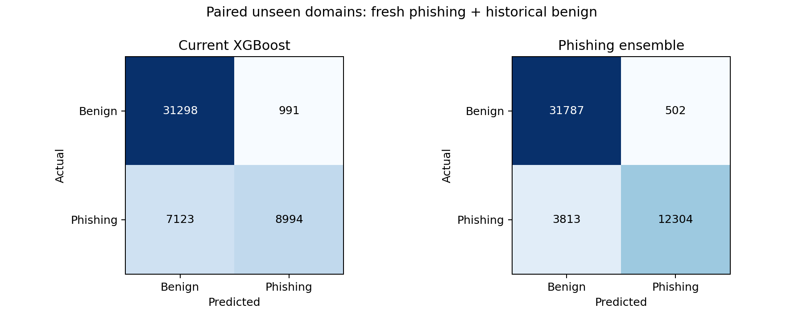
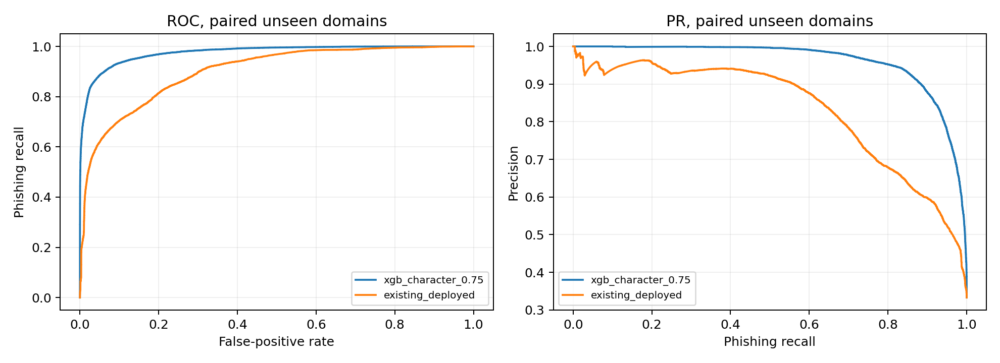

# Evaluation report — 1 November 2026

## Independent reproduction of the historical baseline

The original frozen XGBoost artifact SHA-256 is `08316e688c66e99e2a458802030487a26803f784ba5635b3f05872ed3177c2b9`.
Recomputing historical served rounding gives 94.21% accuracy / 88.85% malicious
recall on 48,803 cleaned Kaggle URLs, and 93.86% / 89.53% on 42,781 unseen-domain
URLs. OpenPhish recall remains 43.24% (128/296) and 38.87% (103/265).
The corrected full-precision path gives 94.18% / 88.79% and 93.82% / 89.47%;
15 rounding-dependent malware decisions change. Phishing-only counts do not.
Earlier live samples matched; a new live request during this work timed out.
These are artifact reproductions, not a claim that every URL was sent to Render.

## Frozen new comparison

| Model | Accuracy | Precision | Phishing recall | F1 | FPR |
|---|---:|---:|---:|---:|---:|
| existing_deployed | 83.24% | 90.08% | 55.80% | 68.91% | 3.07% |
| xgb_character_0.75 | 91.09% | 96.08% | 76.34% | 85.08% | 1.55% |

The paired cohort has 48,406 URLs from 33,285 domains absent from both development
corpora: 16,117 phishing and 32,289 legitimate. All fresh-feed test domains are
absent from the entire new development corpus. The negative data are reserved
historical domains, not independently collected recent browsing.

Confusion matrices use `[[TN, FP], [FN, TP]]`:

- existing_deployed: `[[31298, 991], [7123, 8994]]`.
- xgb_character_0.75: `[[31787, 502], [3813, 12304]]`.

The candidate detects 12,304 phishing URLs versus 8,994
for the baseline, with 502 rather than 991 false positives. These are a measured
improvement, not achievement of every 95% target. At an assumed 1% phishing
prevalence and unchanged sensitivity/specificity, candidate precision would be
33.15%; the observed 96.08% precision does not transfer
automatically to ordinary browsing.

## Phishing-only results

| Cohort | Model | URLs | Recall | 95% domain-bootstrap interval |
|---|---|---:|---:|---:|
| fresh_openphish | existing_deployed | 267 | 67.42% | 49.86%–82.96% |
| fresh_openphish | xgb_character_0.75 | 267 | 83.90% | 74.99%–90.48% |
| fresh_phishtank | existing_deployed | 17,631 | 55.69% | 52.65%–60.21% |
| fresh_phishtank | xgb_character_0.75 | 17,631 | 77.65% | 72.65%–80.63% |
| recent_phishtank_30d | existing_deployed | 2,128 | 51.83% | 49.39%–54.14% |
| recent_phishtank_30d | xgb_character_0.75 | 2,128 | 77.87% | 75.72%–79.94% |
| paired_recent_phishing_30d | existing_deployed | 2,118 | 51.65% | 49.14%–54.01% |
| paired_recent_phishing_30d | xgb_character_0.75 | 2,118 | 77.81% | 75.67%–79.72% |

Fresh OpenPhish is a different snapshot from historical Kaggle OpenPhish; their
recalls must not be compared as a paired before/after experiment. PhishTank
retrieval is not first-seen time. The recent cohort uses actual verification
timestamps, with mixed date formats explicitly parsed before final evaluation.

## Malware and overall malicious results

The malware/benign cohort contains 4,352 reserved URLhaus malware and 73,041
reserved legitimate URLs. This is a within-development-source, domain-separated
test, not a fresh independent malware benchmark. Labels 1 and 2 remain distinct.
The existing artifact uses its frozen threshold; other rows use their separately
validation-selected overall-malicious 1% FPR thresholds. Thus their phishing
and malware operating thresholds are explicitly different.

| Model | Accuracy | Precision | Malware recall | F1 | FPR |
|---|---:|---:|---:|---:|---:|
| existing_deployed | 97.14% | 68.82% | 90.00% | 78.00% | 2.43% |
| binary_malicious | 98.50% | 82.82% | 92.58% | 87.43% | 1.14% |
| three_class | 98.47% | 81.10% | 94.94% | 87.48% | 1.32% |
| separate_specialists | 98.50% | 82.17% | 93.70% | 87.56% | 1.21% |
| xgb_character_0.75 | 98.06% | 83.69% | 81.25% | 82.45% | 0.94% |

All 141,010 reserved test URLs (legitimate, phishing and malware), evaluated as
legitimate versus either malicious type:

| Model | Accuracy | Precision | Malicious recall | F1 | FPR |
|---|---:|---:|---:|---:|---:|
| existing_deployed | 79.39% | 95.82% | 59.84% | 73.68% | 2.43% |
| binary_malicious | 76.93% | 97.75% | 53.36% | 69.03% | 1.14% |
| three_class | 76.48% | 97.38% | 52.61% | 68.31% | 1.32% |
| separate_specialists | 76.86% | 97.62% | 53.30% | 68.95% | 1.21% |
| xgb_character_0.75 | 92.16% | 98.82% | 84.75% | 91.24% | 0.94% |

## Threshold tradeoffs and AUC

Each threshold below was frozen from validation. Its policy name states a
validation objective, not a guarantee of the same FPR on final test. No alternate
row is chosen for release after examining this table.

| Validation policy | Threshold | Test precision | Test phishing recall | Test FPR |
|---|---:|---:|---:|---:|
| fpr_1pct | 0.640824 | 96.08% | 76.34% | 1.55% |
| fpr_05pct | 0.726906 | 97.63% | 70.06% | 0.85% |
| max_f1 | 0.318465 | 86.90% | 90.72% | 6.83% |
| precision_95 | 0.412898 | 90.66% | 87.68% | 4.51% |

Paired candidate ROC-AUC: 0.975922; PR-AUC (average precision):
0.960901. Existing frozen system-score ROC-AUC: 0.900681;
PR-AUC: 0.832655. AUC does not establish recall at a low false-positive
operating point or calibrate the hybrid index.

## Uncertainty and operational outcomes

The following are 1,000 registrable-domain bootstrap percentile intervals on the
paired cohort. Dependence within each domain is retained; campaigns can still
cross domains, so this is not campaign-cluster uncertainty.

| Model | Metric | 95% interval |
|---|---|---:|
| existing_deployed | accuracy | 82.35%–84.13% |
| existing_deployed | precision | 88.31%–91.98% |
| existing_deployed | recall | 52.37%–61.02% |
| existing_deployed | f1 | 65.93%–73.21% |
| existing_deployed | false_positive_rate | 2.76%–3.42% |
| xgb_character_0.75 | accuracy | 88.90%–92.42% |
| xgb_character_0.75 | precision | 95.63%–96.53% |
| xgb_character_0.75 | recall | 71.60%–79.54% |
| xgb_character_0.75 | f1 | 82.16%–86.99% |
| xgb_character_0.75 | false_positive_rate | 1.39%–1.74% |

Binary metrics count only a high-risk alarm as positive; needs-review URLs count
as non-positive. Operational metrics also show abstention, rather than presenting
metrics on decisive predictions as full-coverage accuracy.

| Model | Decisive coverage | Needs review | Phishing in review | Decisive-only accuracy |
|---|---:|---:|---:|---:|
| xgb_character_0.75 | 90.73% | 4,486 | 2,434 | 95.72% |
| existing_deployed | 79.72% | 9,815 | 4,153 | 89.74% |

## ML, rules and threat intelligence

| Model | Accuracy | Precision | Phishing recall | F1 | FPR |
|---|---:|---:|---:|---:|---:|
| xgb_character_0.75 | 91.09% | 96.08% | 76.34% | 85.08% | 1.55% |
| xgb_character_0.75 | 91.21% | 96.12% | 76.69% | 85.31% | 1.55% |

The frozen policy selected pure model mixing over the rule-weighted alternative.
The application still retains the abstract's hybrid rule pipeline with its
existing production model. No existing rule weight was increased to improve a
test score. Structured rule evidence now identifies correlated warnings; they
are not described as independent probabilistic evidence.

Complete threat-intelligence performance is **not independently established**:
the live service reported no feed indicators and no configured reputation key.
Feed-derived test labels are not looked up in those same feeds. Mocked exact
match/expiry/consent/failure tests validate integration behavior, not detection
accuracy. Malware-only and all-type rows use separately validation-tuned
malicious thresholds, identified by `threshold_target` in the results CSV.

## Errors and runtime

Paired error breakdown: PhreshPhish legitimate false alarms fell from 866 to
369, while ealvaradob legitimate false alarms rose from 125 to 133. OpenPhish
misses fell from 87 to 43; paired PhishTank misses fell from 7,036 to 3,770.
The gains are not uniform across legitimate sources. URL-pattern error counts
(root path, HTTPS, query presence) describe the remaining misses:

| Model | False negatives | Root path among misses | HTTPS among misses | Query among misses |
|---|---:|---:|---:|---:|
| existing_deployed | 7,123 | 49.01% | 96.88% | 7.23% |
| xgb_character_0.75 | 3,813 | 40.91% | 93.71% | 23.39% |

These are URL-pattern slices, not adjudicated attack subtypes. Without page
content we cannot reliably assign credential-form or campaign subtype labels.
Valid-looking HTTPS URLs and compromised legitimate hosts can lack the lexical
warning signals available to this offline model. More threshold tuning on these
same final URLs would invalidate the independent test rather than solve that gap.

Total recorded training/search time: 286.8 seconds.
The compact selected candidate is 1.31 MiB;
fresh-process RSS 188.2 MiB, load delta
29.3 MiB, single-URL median
3.37 ms / p95 5.18 ms
over 32 warm predictions. RSS includes interpreter/library overhead, not just trees.
The existing model's local full HTTP API median is 5.17 ms /
p95 6.24 ms over 16 warmed requests, with external services off.
These are local Windows measurements, not Render cold-start/internet latency or
full-API measurements of a deployed candidate.

## Acceptance and deployment

**Candidate rejected for production replacement:** the FPR 95% upper bound is
1.74%, exceeding the
predeclared 1% gate. All other declared gates passed. No alternative final-test
row is promoted. The previous production models are unchanged and available
for rollback; only decision consistency and structured rule explanations were
integrated into the live API.

Final post-push service verification: health HTTP 200,
prediction HTTP 200; active model remains
`2026-10-29T15:42:17.299185+00:00`. The decision patch is
visible
in the live response. The tested API patch has now been released on Render and verified through the Vercel frontend. The original XGBoost model remains selected; no research candidate was deployed.

Overall accuracy, F1, phishing recall and unseen-domain recall do not meet the
95% targets. Further work needs independently adjudicated recent benign deep
links and new phishing campaigns; any new tuning needs a new final test.
The current final feeds cannot become validation data while retaining their
independent-test status. Missing collection dates, source/label confounding,
shared campaigns/templates and feed label errors remain limitations.

